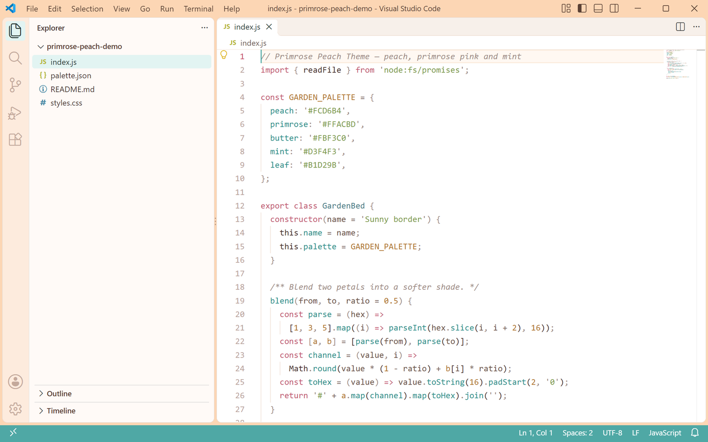
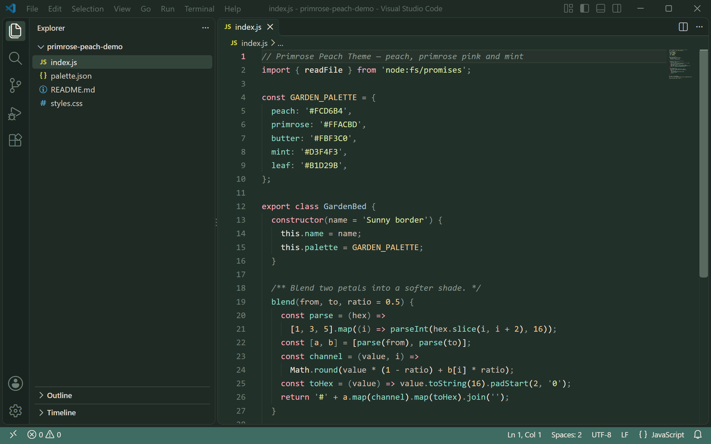

# Primrose Peach Theme

A soft peach theme for VS Code, shipped in two coordinated variants. The light one is white paper with peach, primrose pink and mint; the dark one turns the same palette into a deep moss night. Switching changes the light, not the garden.

一套柔和的蜜桃色主题，浅色和深色两版共用同一套色板。浅色版是纯白纸配上蜜桃、报春粉与薄荷，深色版把同一套颜色变成深苔藓夜色，切换时变的是光线。

## Preview

| Light | Dark |
| --- | --- |
|  |  |

Both previews are captured from a real VS Code window running the theme. 预览图取自真实运行该主题的 VS Code 窗口。

## Palette

| Role | Light | Dark |
| --- | --- | --- |
| Editor background | `#FFFFFF` white paper | `#22302A` moss night |
| Foreground | `#46302C` warm ink | `#F0E6DC` soft cream |
| Side bar | `#FFFAF7` | `#1F2A25` |
| Panel / terminal | `#FFFCF8` | `#1E2823` |
| Title bar | `#FCD6B4` peach | `#1B2621` |
| Tab bar | `#F7F0EA` | `#1E2823` |
| Activity bar | `#FDEBDD` | `#19231F` |
| Status bar | `#4FA8A5` teal | `#3E6B62` |
| Selection | `#CFEDEA` mint | `#3A4A42` |
| Current line | `#FFF8F2` | `#27332C` |
| Borders | `#F0E2D8` | `#33443B` |
| Button | `#C9556E` | `#FFACBD` |
| Cursor | `#4FA8A5` | `#FFACBD` |

Peach `#FCD6B4`, primrose `#FFACBD`, butter `#FBF3C0`, mint `#D3F4F3` and leaf `#B1D29B` carry both variants, so a file still reads as "primrose peach" after switching.

蜜桃 `#FCD6B4`、报春粉 `#FFACBD`、奶油黄 `#FBF3C0`、薄荷 `#D3F4F3` 与嫩叶 `#B1D29B` 贯穿明暗两版，切换后整个文件还是同一座花园。

## Syntax colors

| Syntax | Light | Dark |
| --- | --- | --- |
| Comments | `#A08C86` | `#8A9A90` |
| Keywords | `#C25A72` | `#FFACBD` |
| Strings | `#7E9B4F` | `#D8E4A2` |
| Functions | `#2F8F8B` | `#8FD9C4` |
| Types and classes | `#4A7A86` | `#A8C6D8` |
| Numbers and constants | `#B0742E` | `#F0C88A` |
| Variables | `#46302C` | `#F0E6DC` |
| Properties | `#2F8F8B` | `#8FD9C4` |
| Operators | `#7A6660` | `#B9B3A6` |
| HTML tags | `#C25A72` | `#FFACBD` |

Semantic highlighting is enabled, so variables, parameters, properties, functions and types follow the same mapping in TypeScript, JavaScript, Go, Rust and Python.

已开启语义高亮，TypeScript、JavaScript、Go、Rust 与 Python 里的变量、参数、属性、函数与类型都会落到同一套配色。

## Install

1. Open the Extensions view with `Ctrl+Shift+X`.
2. Search for **Primrose Peach Theme** and install it.
3. Press `Ctrl+K Ctrl+T` and choose `Primrose Peach Theme Light` or `Primrose Peach Theme Dark`.

在扩展面板搜索 **Primrose Peach Theme** 安装，然后用 `Ctrl+K Ctrl+T` 在浅色与深色之间选择。

## License

Non-Commercial License: free for personal, educational and non-commercial use. See the LICENSE file in this repository.

非商业许可证：个人、教育与非商业用途免费使用，详见仓库内的 LICENSE 文件。
